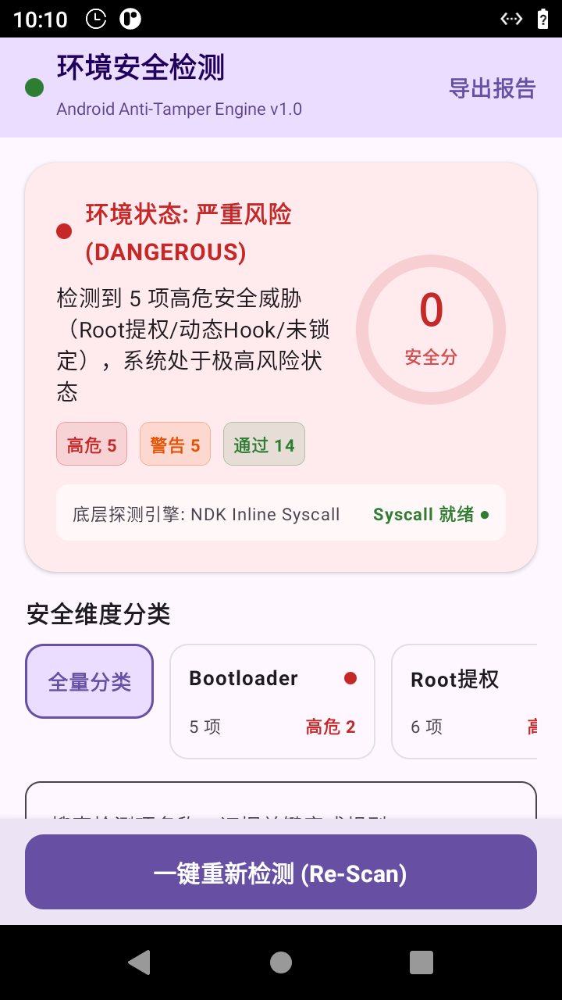
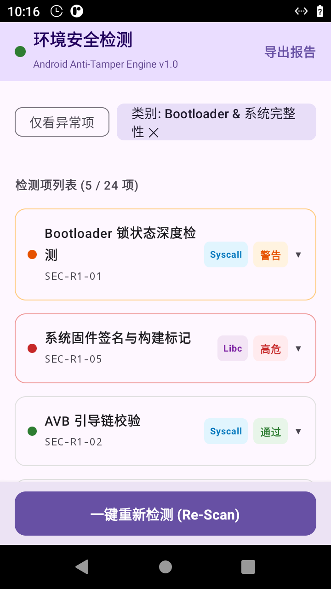

# 🛡️ Android Environment Detector (安卓环境安全检测)

<p align="center">
  <b>一款专为 Android 平台设计的高对抗性底层环境安全与完整性检测工具</b><br>
  <i>深入内核底层与汇编系统调用，全方位识别 Bootloader 解锁、新型 Root（Magisk / KernelSU / APatch）、动态 Hook、内存注入与虚拟容器</i>
</p>

<p align="center">
  
  
  
  
  
</p>

---

## 📸 界面预览

<p align="center">
  
  
  
</p>

---

## ✨ 核心特性

### 1. ⚔️ Native C/C++ 直接系统调用 (Direct Syscall)
面对常见的应用层 Hook 框架（如 SandHook、Dobby 等对 libc 函数如 `fopen`、`open`、`read` 进行的 inline hook），本应用核心探测逻辑完全下沉至 Native C++ 层，并采用内联汇编直接发起系统调用：
- **ARM64 (`arm64-v8a`)**：通过 `svc #0` 硬件中断直接触发系统调用指令。
- **ARM32 (`armeabi-v7a`)**：支持 Thumb-2 与 ARM32 模式下的 `svc #0` 系统调用。
- **x86_64**：通过 `syscall` 指令直接与 Linux 内核交互。
- 直接内联实现 `openat`、`read`、`readlinkat`、`faccessat` 等，彻底绕开 libc 层的任何挂钩。

### 2. 🔍 深度内核级检测能力矩阵

- **🔓 Bootloader 与系统完整性**：
  - 属性级检测：`ro.boot.flash.locked`、`ro.boot.verifiedbootstate`、`ro.boot.vbmeta.device_state` 等底层锁状态。
  - SELinux 状态实时判定（`Enforcing` / `Permissive` / `Disabled`）。
  - 系统构建特征检测（`ro.build.tags` 包含 `test-keys` 与自定义调试固件指纹）。
- **⚡ 全覆盖 Root 隐蔽提权对抗**：
  - 常规检测：标准 `su` 二进制文件与 `PATH` 环境变量遍历。
  - 现代与内核级 Root：深度扫描 `/proc/self/mountinfo` 识别 **KernelSU** 与 **APatch** 内核挂载点特征。
  - **Magisk / Zygisk** 探测：检测异常 `tmpfs` / `overlayfs` 挂载残留、隐藏守护进程及包名特征。
  - 常见及隐藏 Root 管理器包名检测（Magisk、KSU、APatch、SuperSU 等）。
- **💉 动态 Hook 与内存注入探测**：
  - **Xposed / LSPosed** 框架特征：堆栈回溯检查、类加载器特征与模块注入识别。
  - **Frida** 深度对抗：探测默认与非标通信端口（27042 等）、扫描特征线程（`gum-js-loop`、`gmain`）、命名管道与 `/proc/self/maps` 映射段中的 `frida-agent` / `linjector` 匿名可执行内存。
- **📦 虚拟容器、双开分身与调试对抗**：
  - 虚拟沙箱特征：应用私有目录路径异常重定向检测（识别 VirtualApp、太极、双开/多开空间）。
  - 模拟器特征：CPU/主板特征、QEMU/VBox 虚拟硬件驱动、传感器与电池状态综合指纹。
  - 调试对抗：JDWP 调试器连接检测、ADB 调试状态、`/proc/self/status` 读取 `TracerPid` 追踪及防 ptrace 附加。

### 3. 🎨 现代化 Jetpack Compose 用户界面
- **非对称安全评分引擎**：
  - 区别于传统粗糙的算术平均分，采用非对称降级模型。一旦检出“高危”级项（如 Root 或注入），总分立即上限封顶至 40 分危险区间；单个警告项最高不超过 75 分，杜绝“带病优等”假象。
- **多维分类筛选看板**：
  - 涵盖全部、Bootloader、Root、Hook、虚拟环境与调试等 5 大维度，支持一键切换仅查看异常项。
- **可展开的技术证据链**：
  - 每一项检测均提供详细的技术说明与底层采集到的原始数据证据（如路径、属性值、十六进制或状态码）。
- **结构化诊断报告导出**：
  - 支持将检测快照一键序列化为标准 JSON 或格式化纯文本报告，并通过 Android 原生 `FileProvider` 进行跨应用安全分享。

---

## 🏗️ 项目架构

```
.
├── app/
│   ├── src/main/
│   │   ├── cpp/                     # Native C/C++ 底层检测引擎 (CMake / NDK)
│   │   │   ├── src/
│   │   │   │   ├── syscall_helper.cpp   # Direct Syscall 内联汇编 (arm64/arm32/x86_64)
│   │   │   │   ├── native_maps.cpp      # /proc/self/maps 内存映射穿透扫描
│   │   │   │   ├── native_mounts.cpp    # /proc/self/mountinfo 挂载点分析 (KSU/APatch/Magisk)
│   │   │   │   ├── native_status.cpp    # /proc/self/status 反调试状态解析
│   │   │   │   ├── native_props.cpp     # 底层系统属性读取
│   │   │   │   └── security_engine_jni.cpp # JNI 桥接层
│   │   │   └── CMakeLists.txt
│   │   ├── java/com/security/environment/
│   │   │   ├── domain/              # 核心业务逻辑与探测器
│   │   │   │   ├── detectors/       # BL/Root/Hook/VirtualEnv/Debug 各模块探测器
│   │   │   │   ├── SecurityScorer.kt # 非对称权重安全评分引擎
│   │   │   │   └── DetectionCoordinator.kt # 协程异步检测调度
│   │   │   ├── ui/                  # Jetpack Compose UI
│   │   │   │   └── screens/         # 仪表盘、卡片、导出弹窗
│   │   │   └── data/export/         # 诊断报告序列化 (JSON/Text)
│   └── build.gradle.kts
├── tests/                           # 自动化测试套件 (Tiers 1-4, 共 225 项测试)
├── scripts/
│   └── run_e2e_tests.sh             # E2E 自动化测试脚本
├── PROJECT.md                       # 项目工程规格与验收文档
└── TEST_INFRA.md                    # 测试基础设施文档
```

---

## 🛠️ 构建与测试

### 环境要求
- JDK 17+
- Android SDK (API 34, minSdk 24)
- Android NDK (r25c+)
- CMake 3.22.1+

### 编译 APK
```bash
# 构建 Debug 版 APK
./gradlew assembleDebug

# 构建产物位于：
# app/build/outputs/apk/debug/app-debug.apk
```

### 运行单元测试
```bash
# 运行 129 项 JVM 单元测试
./gradlew testDebugUnitTest
```

### 运行全量 E2E 端到端测试
```bash
# 运行包含真实场景仿真、边界注入与加权评分的 225 项 E2E 测试
./scripts/run_e2e_tests.sh
```

---

## 📄 开源许可证

本项目基于 [MIT License](LICENSE) 开源。仅供 Android 安全防御研究、设备完整性评估及学术交流使用。
